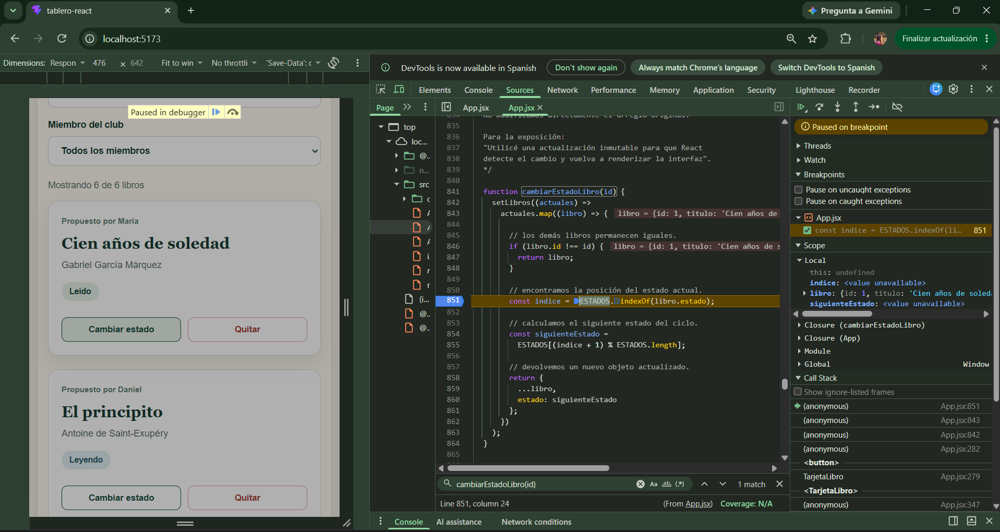
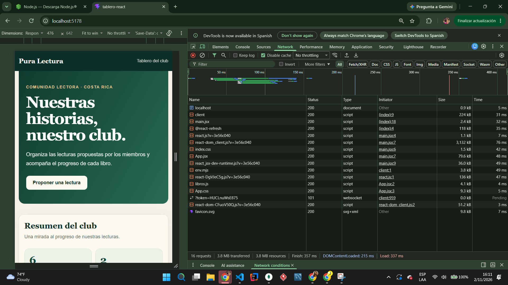
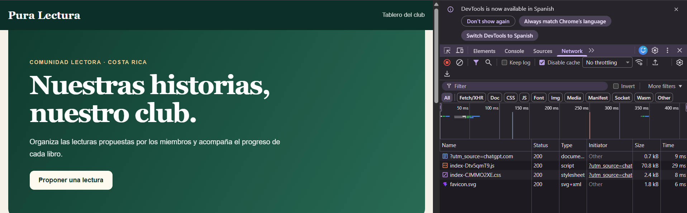
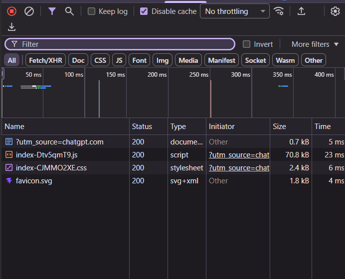

# Depuración y rendimiento — Pura Lectura

## 1. Depuración con Chrome DevTools

Se utilizó Chrome DevTools para comprobar el funcionamiento de la aplicación React, específicamente la actualización del estado de lectura de los libros.

### Procedimiento

1. Se ejecutó la aplicación React mediante el servidor de desarrollo de Vite.
2. Se abrió la pestaña **Sources** de Chrome DevTools.
3. Se localizó el archivo `App.jsx`.
4. Se colocó un breakpoint en la función `cambiarEstadoLibro(id)`, en la instrucción `const indice = ESTADOS.indexOf(libro.estado);`.
5. Se presionó el botón **Cambiar estado** del libro *Cien años de soledad*.
6. Chrome detuvo la ejecución en la línea 851 del archivo mostrado por DevTools.

### Variables observadas

En el panel **Scope** se identificó el objeto `libro`, correspondiente a *Cien años de soledad*. También se observó que las variables `indice` y `siguienteEstado` aún no tenían valores disponibles porque la ejecución se encontraba detenida antes de calcularlas.

El panel **Call Stack** permitió identificar la secuencia de llamadas asociada al evento del botón.

### Resultado

Se confirmó que la acción del usuario llega correctamente a la función `cambiarEstadoLibro(id)`.

La función utiliza `map()` para generar un nuevo arreglo y devuelve una copia del libro con su estado actualizado mediante el operador de propagación (`...libro`). De esta manera se evita modificar directamente el estado anterior de React.

Esta prueba fue una inspección del funcionamiento de la aplicación, no la corrección de un error específico.

### Evidencia

## 2. Medición de rendimiento con Network

Se utilizó Chrome DevTools, en la pestaña **Network**, con la caché deshabilitada para observar las solicitudes de la aplicación React.

Se comparó la carga en el servidor de desarrollo de Vite con la carga de la versión compilada para producción.

| Indicador | Desarrollo | Producción |
|---|---:|---:|
| Solicitudes | 16 | 4 |
| Transferencia | 3,8 MB | Aproximadamente 75,7 kB |
| Tiempo de carga | 337 ms | No registrado |

La transferencia de producción se estimó sumando los tamaños visibles de los cuatro recursos de la captura: documento HTML, JavaScript, CSS y favicon.

### Interpretación

La versión de producción registró un 75 % menos de solicitudes y aproximadamente un 98 % menos de transferencia que el servidor de desarrollo.

La reducción se explica principalmente porque la compilación de Vite genera archivos optimizados y excluye herramientas utilizadas durante el desarrollo.

**Limitación:** esta comparación demuestra la diferencia entre los entornos de desarrollo y producción, pero no constituye una medición antes/después de una optimización manual del código.

### Evidencias

## 3. Optimización de recursos en la aplicación JavaScript

En la aplicación `buscador-js` se utilizan portadas de Open Library en tamaño mediano (`-M.jpg`), evitando solicitar versiones de mayor resolución cuando no son necesarias para las tarjetas.

También se contempla la carga diferida de imágenes mediante `loading="lazy"`, para reducir la descarga inicial de portadas que todavía no están visibles.

Estas decisiones buscan disminuir el consumo de datos y mejorar la experiencia de navegación.

**Limitación:** no se realizó una medición controlada antes/después de estas optimizaciones, por lo que no se atribuye una reducción numérica específica a ellas.

## 4. Conclusiones

La depuración permitió inspeccionar una actualización de estado en React mediante un breakpoint real, revisar variables locales y observar la pila de llamadas.

Las mediciones de Network mostraron una diferencia significativa entre el servidor de desarrollo y la compilación de producción de Vite.

Las capturas incluidas documentan los resultados observados durante las pruebas.